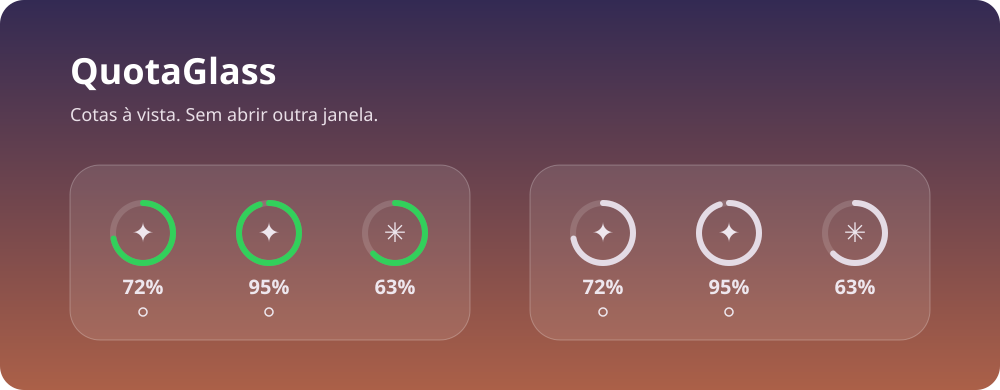

<div align="center">

# QuotaGlass
### Suas cotas. Um olhar. A Mesa do Mac.



   

**Widget nativo para acompanhar até três assinaturas de Codex e Claude.**

[Começar](#começar) · [Conexões](#conexões) · [Transparência](#transparência) · [Privacidade](#privacidade)

</div>

## Um painel que cabe no seu dia

Anéis mostram a porcentagem **restante**, com os ícones dos provedores no centro e o percentual abaixo. Sem e-mails, horários ou títulos no widget: os detalhes ficam no aplicativo da barra de menus.

| Recurso | Como funciona |
| --- | --- |
| Widget de verdade | Extensão WidgetKit, tamanho médio, até três contas escolhidas nas configurações. |
| Vidro translúcido | Fundo desfocado; as cores acompanham o estado de renderização do sistema. |
| Login no aplicativo | Codex abre o navegador oficial; Claude usa uma sessão WebKit separada por conta. |
| Indicadores de reset | Círculo vazado ou emoji personalizado, com cor opcional. Só aparecem quando há contagem disponível. |
| Detalhes sob demanda | Barra de menus com janelas de uso e próximas renovações. |
| Painel na Mesa | Extra opcional, independente do widget. |

> A imagem acima é uma ilustração com valores fictícios, não uma captura de contas reais.

## Começar

### Requisitos

- Mac com **Apple Silicon e macOS 27**.
- Ferramentas Xcode com **SDK macOS 27**, Swift e Python 3.
- [Codex CLI oficial](https://developers.openai.com/codex/cli) instalado para conectar contas Codex.

```sh
git clone https://github.com/JoaoPauloNA/QuotaGlass.git
cd QuotaGlass
chmod +x build.sh
./build.sh
```

Copie `build/QuotaGlass.app` para a pasta Aplicativos do seu usuário e abra o app. Nas configurações, conecte suas contas e escolha os três lugares do widget. Na Mesa, abra **Editar Widgets**, procure **Cotas** e adicione o widget médio.

O build usa assinatura ad hoc e gera um caminho de cache específico do usuário local. **Compile no Mac e no usuário que vão executar o aplicativo.** Esta versão publica código-fonte; não inclui instalador assinado ou notarizado.

## Conexões

### Codex / ChatGPT

Cada conta usa um processo separado do `codex app-server`, com perfil local próprio. O app solicita login ChatGPT pelo navegador e lê os limites via `account/rateLimits/read`. As credenciais ficam no Keychain por meio do CLI oficial. O caminho do executável pode ser ajustado nas configurações.

Não são criadas conversas nem enviadas tarefas de inferência para consultar cotas. Chaves de API herdadas do shell não substituem o login da assinatura.

Referência: [documentação oficial do app-server](https://developers.openai.com/codex/app-server).

### Claude — experimental

O login acontece no site Claude dentro de uma janela WebKit, com armazenamento de sessão isolado por conta. A leitura usa os endpoints do próprio site, que **não são uma API pública estável**. Mudanças no site, desafios de autenticação e bloqueios podem impedir o funcionamento.

A integração está implementada e compila, mas **ainda não foi verificada com uma sessão autenticada nesta versão**. Não use chave de API da Anthropic para tentar obter cotas de uma assinatura Claude Pro/Max.

A contagem de resets do Claude permanece desconhecida e não é inventada. Quando não há uma contagem fornecida pela fonte, o indicador fica ausente.

## Atualização

Com o app aberto e o widget, painel ou menu em uso, o aplicativo tenta atualizar a cada **um minuto**. As consultas do Claude têm intervalo mínimo de **cinco minutos**; em caso de HTTP 429, a última leitura disponível é mantida e a mensagem aparece no app.

O horário de atualização indica o ciclo local de consulta, não garante que toda fonte entregou uma leitura nova. O macOS controla quando o WidgetKit redesenha: não há garantia de atualização visível a cada minuto. O app precisa continuar em execução para buscar novas cotas.

## Transparência

O widget usa `preferredBackgroundStyle(.blur)` do WidgetKit, identificado no comportamento do widget Bateria do macOS 27. Essa interface **não está exposta no SDK público**: o build gera uma declaração local, confirma os símbolos no SDK e vincula o framework do sistema.

Nenhum arquivo do widget Bateria ou do macOS é modificado ou incluído neste repositório. A implementação é experimental, restrita ao macOS 27 e **não é adequada para submissão à App Store com essa API privada**. Atualizações do sistema podem exigir adaptação. [Detalhes técnicos](docs/ARCHITECTURE.md).

## Privacidade

- Sem servidor intermediário, painel externo, telemetria ou analytics implementados pelo QuotaGlass.
- Autenticação e consultas são realizadas com os respectivos provedores; suas políticas continuam aplicáveis.
- Perfis e preferências ficam localmente. Cookies do Claude permanecem no armazenamento WebKit; o app não extrai esses cookies.
- Um snapshot local de cotas alimenta o widget. Ele pode conter rótulos/e-mail da conta para seleção e acessibilidade, embora o e-mail não apareça visualmente no widget.
- Credenciais, snapshots, logs e arquivos de build não são publicados no repositório.

Não inclua dados de conta, tokens ou capturas pessoais ao abrir uma issue. Consulte [SECURITY.md](SECURITY.md) antes de relatar uma vulnerabilidade.

## Estado do projeto

**0.1.0 · primeira versão pública experimental.** Compilação local concluída; revisão estática dos fluxos e dos arquivos destinados à publicação realizada. Login autenticado e execução completa desta versão independente ainda precisam de verificação funcional. A validação visual anterior da transparência não valida as novas conexões.

Contribuições são bem-vindas. Abra uma issue descrevendo o comportamento esperado e a versão do macOS; mudanças devem preservar a separação entre credenciais e snapshots.

## Licença e marcas

Código sob [MIT](LICENSE). Logos e nomes de provedores pertencem aos seus titulares e são utilizados para identificação; veja [origem dos assets](Resources/brands/SOURCES.md). QuotaGlass é um projeto independente, sem afiliação com Apple, OpenAI ou Anthropic.
